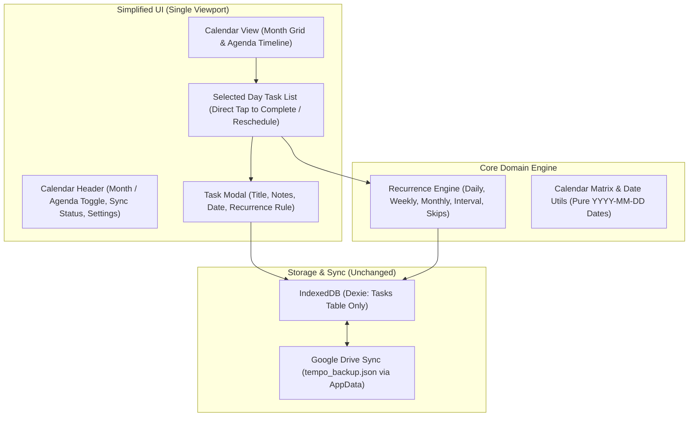

# Tempo: Feature Pruning & Simplification Plan

## Executive Summary

Tempo was initially created with an ambition to replicate the broad feature set of **TickTick**. Over time, however, actual usage has crystallized around a very specific, lightweight workflow for a single user.

### Current Usage Profile
The user's actual workflow consists solely of five operations:
1. **Calendar View**: Navigating the calendar (month and agenda views).
2. **Task Creation for Specific Days**: Creating tasks for particular dates, and recurring tasks. **Never** sets a time of day.
3. **Marking as Deleted**: Deleting tasks (soft-delete tombstones).
4. **Moving Tasks Between Days**: Rescheduling tasks across days on the calendar.
5. **Skipping Tasks**: Skipping single occurrences of recurring tasks.

*Infrastructure retained*: Local IndexedDB (Dexie.js), private Google Drive background sync (`tempo_backup.json`), and PWA updates.

### Complexity Reduction Opportunity
- **Current Source Code Size**: ~11,970 lines of TypeScript/React code (including tests).
- **Potential Code to Remove**: **~8,100 lines (~68% of the codebase)**.
- **Architectural Benefits**: Eliminates complex routing, multi-criteria sorting engines, natural language token parsing, notification daemon hooks, secondary layout modes (split panes, drawers, sidebars), and reduces the `Task` data model to pure routines.

---

## Ranked Feature Removal Catalog (Ordered by Complexity)

The following table provides an overview of all candidate features to remove, ranked from highest complexity to lowest:

| Rank | Feature | Scope / Files | Estimated LOC | Complexity Level | Status |
|---|---|---|---|---|---|
| **1** | **Non-Calendar Smart Lists & Traditional List Views** | Sidebar, Drawer, Today, Tomorrow, Next 7, Inbox, All, Completed views, empty states | ~1,500 LOC | Critical | **Completed** |
| **2** | **Lists & Folders Organizational Hierarchy** | `lists` & `folders` tables, drawer sheets, list colors, `listId` dependencies | ~1,100 LOC | High | **Completed** |
| **3** | **TickTick CSV & Backup Import Subsystem** | `ticktickImport.ts`, `csvParse.ts`, repeat/timezone parsing, import UI | ~950 LOC | High | **Kept (deferred)** |
| **4** | **Task Detail Pane & Subtasks / Checklists** | `TaskDetailPane.tsx`, subtask models, subtask CRUD, card previews | ~800 LOC | High | **Completed** |
| **5** | **Time-of-Day, Due Time Pickers & Push Notifications** | `notifications.ts`, Web Notification API, time pickers, 12h/24h time formatting | ~650 LOC | Moderate-High | **Completed** |
| **6** | **Natural Language Quick Add & Quick Capture** | `quickCapture.ts`, `QuickAddSheet.tsx`, token regex parsers (`#tag`, `!priority`) | ~580 LOC | Moderate | **Completed** |
| **7** | **Custom Saved Filters & Query Builder** | `filters.ts`, `SavedFilterModal.tsx`, `savedFilters` table, query evaluator | ~550 LOC | Moderate | **Completed** |
| **8** | **Swipe Actions & Manual Drag-and-Drop Reordering in Lists** | `SwipeActionButton.tsx`, `ReorderableTaskList.tsx`, `reorder.ts` | ~550 LOC | Moderate | **Kept (retained)** |
| **9** | **Task Grouping & Multi-Criteria Sorting Engine** | `groupSort.ts`, `sorting.ts`, `taskGroups.ts`, `GroupSortSheet.tsx` | ~450 LOC | Moderate | **Completed** |
| **10** | **Batch Selection & Bulk Operations Mode** | `SelectionBar.tsx`, `batch.ts`, multi-select state in `App.tsx` | ~450 LOC | Moderate | **Completed** |
| **11** | **Dead / Orphaned Code Removal** | `KanbanBoard.tsx`, `StatsStrip.tsx`, uncalled `parseQuickCapture` | ~450 LOC | Low-Hanging Fruit | **Completed** |
| **12** | **"Plan My Day" Daily Planning Workflow** | `PlanDaySheet.tsx`, `planDay.ts`, morning review wizard | ~280 LOC | Low-Moderate | **Completed** |
| **13** | **Priority Levels & Urgency Flagging** | `priority` field (`high`, `medium`, `low`), flags, urgency logic | ~250 LOC | Low | **Completed** |
| **14** | **Tags System** | `tags` string array, tag parsing, tag chips | ~200 LOC | Low | **Completed** |
| **15** | **Pinned Tasks** | `pinned` boolean, pin toggle buttons, pinned card badges | ~150 LOC | Low | **Completed** |
| **16** | **Today Tips & Motivational Banners** | `TodayTipBanner.tsx`, `CalendarTodayTip.tsx`, `LightbulbIcon.tsx` | ~160 LOC | Low | **Completed** |
| **17** | **Global Keyboard Shortcuts & Search View** | `useKeyboardShortcuts.ts`, search mode and filters | ~270 LOC | Low | **Completed** |
| **18** | **Tab Bar Customization & Extraneous Settings** | Tab reordering settings, quick stats summary, sample task loaders | ~200 LOC | Low | **Completed** |

---

## Detailed Feature Analysis & Removal Plans

### 1. Non-Calendar Smart Lists & Traditional List Views
* **Description**: TickTick organizes tasks into views like *Inbox*, *Today*, *Tomorrow*, *Next 7 Days*, *All Open*, and *Completed*. Tempo reproduces these with a desktop sidebar, mobile drawer, bottom bar navigation, empty illustrations (`EmptyTodayState`, `EmptyInboxState`), and view-switching logic in `App.tsx`.
* **Files Involved**:
  - `src/domain/smartLists.ts` (158 LOC) & `src/domain/__tests__/smartLists.test.ts` (100 LOC)
  - `src/components/shell/SidebarNav.tsx` (185 LOC)
  - `src/components/drawer/MobileDrawer.tsx` (176 LOC)
  - `src/components/drawer/SmartListIcon.tsx` (97 LOC)
  - `src/components/shell/EmptyTodayState.tsx` (70 LOC)
  - `src/components/shell/EmptyInboxState.tsx` (77 LOC)
  - `src/components/shell/MobileBottomBar.tsx` (148 LOC)
  - `src/components/shell/IconRail.tsx` (77 LOC)
  - Large portions of `src/App.tsx` (over 400 LOC of view routing, activeView state, header title resolvers)
* **Complexity Removed**: ~1,500 LOC. Eliminates entire layout scaffolding (collapsible sidebar, responsive drawer, view switching).
* **Removal Plan**:
  1. Set `AppView` strictly to `'calendar-month'` or `'calendar-agenda'` (or a single toggle between Month and Agenda).
  2. Delete `SidebarNav.tsx`, `MobileDrawer.tsx`, `SmartListIcon.tsx`, `EmptyTodayState.tsx`, `EmptyInboxState.tsx`, `IconRail.tsx`, and `smartLists.ts`.
  3. Simplify `App.tsx` layout into a single, clean header with month/agenda toggle, sync status, and settings button, with the calendar filling the viewport.

---

### 2. Lists & Folders Organizational Hierarchy
* **Description**: Tasks in TickTick belong to custom lists (e.g. "Work", "Home") that are grouped into folders, with custom colors and icons. In Tempo, this creates an entire relational structure in Dexie (`lists`, `folders` tables), foreign keys on tasks (`listId`), and complex sync merge logic.
* **Files Involved**:
  - `src/components/drawer/DrawerSheets.tsx` (172 LOC: AddListSheet, AddFolderSheet, ItemActionSheet)
  - `src/components/drawer/drawerBits.tsx` (73 LOC)
  - `src/theme/listColors.ts` (31 LOC)
  - `src/db/db.ts` (schema for `lists` and `folders`, live queries, indexes)
  - `src/domain/merge.ts` (merge logic for lists and folders across devices)
  - `src/sync/googleDrive.ts` (`lists` and `folders` serialization in `tempo_backup.json`)
* **Complexity Removed**: ~1,100 LOC. Tasks become autonomous standalone routines. Eliminates multiple modal sheets and color palette pickers.
* **Removal Plan**:
  1. Remove `listId` requirement from task creation and queries. Either make `listId` optional/omitted or point legacy records to an implicit default.
  2. Remove `DrawerSheets.tsx`, `drawerBits.tsx`, and `listColors.ts`.
  3. Remove `lists` and `folders` tables from `db.ts` (or maintain a dummy schema for backward compatibility if desired), and remove list/folder resolution in `merge.ts`.
  4. Remove list badges from task cards and list pickers from modal forms.
* **Schema follow-through (done):** Dexie v7 drops the `lists` and `folders` stores and deletes `task.listId`. Sync version 5 writes tasks only. Old backup files that still contain those keys still import their tasks.

---

### 3. TickTick CSV & Backup Import Subsystem
* **Description**: A comprehensive parser engine designed to ingest TickTick CSV exports, parsing human-readable recurrence strings, ERULE/RRULE standards, priorities, timezones, and header variations.
* **Files Involved**:
  - `src/domain/ticktickImport.ts` (544 LOC) & `src/domain/__tests__/ticktickImport.test.ts` (260 LOC)
  - `src/domain/csvParse.ts` (67 LOC) & `src/domain/__tests__/csvParse.test.ts` (40 LOC)
  - Import UI section in `src/components/settings/SettingsPage.tsx` and `dataTransfer.ts`
* **Complexity Removed**: ~950 LOC. This was a one-time migration bridge from TickTick that is no longer needed now that the user is running Tempo.
* **Removal Plan**:
  1. Delete `src/domain/ticktickImport.ts`, `src/domain/csvParse.ts`, and their test files.
  2. Remove the "Import TickTick CSV" button and file drop handler from `SettingsPage.tsx` and `dataTransfer.ts`.
  3. Keep the lightweight JSON export/backup feature for data export safety.

---

### 4. Task Detail Pane & Subtasks / Checklists [COMPLETED]
* **Description**: A side-by-side desktop inspector / mobile bottom sheet (`TaskDetailPane.tsx`) allowing inline viewing of task metadata, combined with an interactive subtasks/checklist system (`Subtask[]`).
* **Files Involved**:
  - `src/components/TaskDetailPane.tsx` (449 LOC)
  - Subtask handling in `src/components/TaskModal.tsx` (lines 239–295)
  - Subtask rendering in `src/components/TaskCard.tsx` (lines 472–487)
  - `Subtask` interface and references in `src/types/task.ts`
* **Complexity Removed**: ~800 LOC. Greatly simplifies the UI: clicking a task directly opens the edit modal, without maintaining a split pane or secondary inspector state.
* **Removal Plan**:
  1. Delete `src/components/TaskDetailPane.tsx`.
  2. In `App.tsx`, remove `selectedTaskId` inspector pane state and replace click handling so selecting a task opens `TaskModal`.
  3. Remove subtask array editing and checkbox toggling from `TaskModal.tsx` and `TaskCard.tsx`.
  4. Deprecate `subtasks` in `src/types/task.ts`.

---

### 5. Time-of-Day, Due Time Pickers & Push Notifications [COMPLETED]
* **Description**: The user creates tasks for *days*, never specifying a *time of day*. Tempo currently contains an entire Web Notification background scheduler, time pickers (`dueTime`, `hasTime`), 12h/24h time display preferences, and time parsing utilities in `dueAt`.
* **Files Involved**:
  - `src/hooks/useDueNotifications.ts` (92 LOC)
  - `src/domain/notifications.ts` (201 LOC) & `src/domain/__tests__/notifications.test.ts` (90 LOC)
  - Time input controls in `src/components/TaskModal.tsx` (lines 528–545)
  - Time format settings in `src/components/settings/SettingsPage.tsx` and `src/prefs/prefs.ts`
  - `splitDueAt`, time parsing, and time formatting across `recurrence.ts` and `calendarUi.ts`
* **Complexity Removed**: ~650 LOC. Standardizes `dueAt` to a pure ISO date string (`YYYY-MM-DD`). Eliminates notification permissions, timers, audio cues, and time formatting edge cases.
* **Removal Plan**:
  1. Delete `src/hooks/useDueNotifications.ts`, `src/domain/notifications.ts`, and `notifications.test.ts`.
  2. Remove the notification toggle and default reminder time section from `SettingsPage.tsx`.
  3. Remove the "Include time" checkbox and `<input type="time">` from `TaskModal.tsx`.
  4. Simplify `dueAt` throughout `recurrence.ts` and `calendarUi.ts` to expect only date strings (`YYYY-MM-DD`).

---

### 6. Natural Language Quick Add & Quick Capture [COMPLETED]
* **Description**: A multi-field quick add sheet and natural language token extractor designed to parse input strings like `"Buy milk tomorrow #errands !high 3pm"`. Much of this is already disconnected dead code.
* **Files Involved**:
  - `src/domain/quickCapture.ts` (152 LOC) & `src/domain/__tests__/quickCapture.test.ts` (45 LOC)
  - `src/components/QuickAddSheet.tsx` (321 LOC)
  - `src/components/QuickCaptureModal.tsx` (2 LOC back-compat export)
  - `src/domain/quickAdd.ts` (45 LOC) & `src/domain/__tests__/quickAdd.test.ts` (40 LOC)
* **Complexity Removed**: ~580 LOC. Eliminates token extraction regexes and floating modal sheets.
* **Removal Plan**:
  1. Delete `src/domain/quickCapture.ts` and its test file.
  2. Delete `QuickAddSheet.tsx`, `QuickCaptureModal.tsx`, `quickAdd.ts`, and `quickAdd.test.ts`.
  3. Wire the "Add Task" button (plus icon) in the calendar header directly to open `TaskModal.tsx` with the currently focused calendar day prefilled.

---

### 7. Custom Saved Filters & Query Builder [COMPLETED]
* **Description**: TickTick's custom filter feature allowing complex compound queries based on priorities, due date buckets, lists, and tags, with persistence in a `savedFilters` database table.
* **Files Involved**:
  - `src/components/SavedFilterModal.tsx` (293 LOC)
  - `src/domain/filters.ts` (102 LOC) & `src/domain/__tests__/filters.test.ts` (90 LOC)
  - `savedFilters` Dexie table in `src/db/db.ts`
  - Filter sync support in `src/sync/googleDrive.ts` and `src/domain/merge.ts`
* **Complexity Removed**: ~550 LOC. Eliminates a dynamic query evaluator, modal filter builder, and dedicated DB table.
* **Removal Plan**:
  1. Delete `src/components/SavedFilterModal.tsx`.
  2. Delete `src/domain/filters.ts` and `filters.test.ts`.
  3. Remove `savedFilters` table from `db.ts` and sync logic from `merge.ts` and `googleDrive.ts`.
  4. Remove `filter:${id}` routing in `App.tsx`.

---

### 8. Swipe Actions & Manual Drag-and-Drop Reordering in Lists
* **Description**: Gestures on list rows allowing users to swipe left to complete, swipe right to reschedule, or drag rows up and down to change manual display order (`sortOrder`). (Note: Swiping the calendar month carousel is a separate feature and is retained).
* **Files Involved**:
  - `src/components/SwipeActionButton.tsx` (257 LOC) & `src/components/__tests__/swipeActions.test.ts` (200 LOC)
  - `src/components/ReorderableTaskList.tsx` (468 LOC)
  - `src/domain/reorder.ts` (14 LOC) & `src/components/__tests__/reorder.test.ts` (30 LOC)
  - `sortOrder` maintenance in `Task` model
* **Complexity Removed**: ~550 LOC. Eliminates gesture handling physics, touch start/move/end state machines, and index recalculation.
* **Removal Plan**:
  1. Delete `SwipeActionButton.tsx` and `swipeActions.test.ts`.
  2. Delete `ReorderableTaskList.tsx`, `reorder.ts`, and `reorder.test.ts`.
  3. In calendar day views, render simple `TaskCard` rows with straightforward click actions.

---

### 9. Task Grouping & Multi-Criteria Sorting Engine [COMPLETED]
* **Description**: A multi-field grouping (by list, due date, priority, title, none) and sorting system (by sortOrder, due date, priority, title) accessed via a dedicated bottom sheet (`GroupSortSheet.tsx`).
* **Files Involved**:
  - `src/domain/groupSort.ts` (127 LOC) & `src/domain/__tests__/groupSort.test.ts` (110 LOC)
  - `src/domain/sorting.ts` (79 LOC) & `src/domain/__tests__/sorting.test.ts` (95 LOC)
  - `src/domain/taskGroups.ts` (71 LOC) & `src/domain/__tests__/taskGroups.test.ts` (40 LOC)
  - `src/components/menu/GroupSortSheet.tsx` (68 LOC)
* **Complexity Removed**: ~450 LOC. In calendar views, tasks are naturally grouped by calendar date and completion status; external grouping and sorting algorithms are redundant.
* **Removal Plan**:
  1. Delete `GroupSortSheet.tsx`.
  2. Delete `groupSort.ts`, `sorting.ts`, `taskGroups.ts`, and their corresponding test files.
  3. Sort tasks in the calendar day list purely by title or completion status.

---

### 10. Batch Selection & Bulk Operations Mode [COMPLETED]
* **Description**: TickTick's batch editing mode: selecting multiple tasks via checkboxes, with a bottom toolbar (`SelectionBar.tsx`) allowing bulk completion, rescheduling, moving to lists, or deletion.
* **Files Involved**:
  - `src/components/menu/SelectionBar.tsx` (159 LOC)
  - `src/domain/batch.ts` (51 LOC) & `src/domain/__tests__/batch.test.ts` (60 LOC)
  - Multi-select state (`selectMode`, `selectedTaskIds`, shift-select handlers) in `src/App.tsx` and `TaskCard.tsx`
* **Complexity Removed**: ~450 LOC. Removes multi-select state management and bulk database transaction logic.
* **Removal Plan**:
  1. Delete `SelectionBar.tsx`, `batch.ts`, and `batch.test.ts`.
  2. Remove `selectMode`, `selectedTaskIds`, and batch event handlers from `App.tsx`.
  3. Remove multi-select checkboxes from `TaskCard.tsx`.

---

### 11. Dead / Orphaned Code Removal (Low-Hanging Fruit) [COMPLETED]
* **Description**: Code components and modules created during earlier iterations that are currently not imported or rendered anywhere in the application.
* **Files Involved**:
  - `src/components/KanbanBoard.tsx` (145 LOC) — completely unreferenced component
  - `src/components/StatsStrip.tsx` (41 LOC) — completely unreferenced component
  - `src/domain/quickCapture.ts` (152 LOC) — only referenced by its own unit test
  - `src/domain/stats.ts` (80 LOC) & `stats.test.ts` (45 LOC) — computes 5 stats buried in settings
* **Complexity Removed**: ~450 LOC. Zero UI or behavioral impact.
* **Removal Plan**:
  1. Delete `KanbanBoard.tsx`, `StatsStrip.tsx`, `quickCapture.ts`, `quickCapture.test.ts`, `stats.ts`, and `stats.test.ts`.
  2. Remove the "Quick stats" table in `SettingsPage.tsx`.

---

### 12. "Plan My Day" Daily Planning Workflow [COMPLETED]
* **Description**: A morning review wizard modal inspired by TickTick / Microsoft To Do that prompts users to review overdue tasks and reschedule them into today.
* **Files Involved**:
  - `src/components/PlanDaySheet.tsx` (140 LOC)
  - `src/domain/planDay.ts` (53 LOC) & `src/domain/__tests__/planDay.test.ts` (70 LOC)
  - Trigger buttons in `src/App.tsx` (lines 1130, 1192)
* **Complexity Removed**: ~280 LOC.
* **Removal Plan**:
  1. Delete `PlanDaySheet.tsx`, `planDay.ts`, and `planDay.test.ts`.
  2. Remove `isPlanDayOpen` state and trigger buttons in `App.tsx`.

---

### 13. Priority Levels & Urgency Flagging *(Completed)*
* **Description**: 4-tier task priorities (`high`, `medium`, `low`, `none`) with red/yellow/blue flag badges, urgency calculations, and priority-based filters.
* **Files Involved**:
  - Priority selectors in `src/components/TaskModal.tsx` and `TaskDetailPane.tsx`
  - Priority badge and urgency indicators in `src/components/TaskCard.tsx`
  - `TaskPriority` and `TaskUrgency` types in `src/types/task.ts`
* **Complexity Removed**: ~250 LOC.
* **Removal Plan**:
  1. Remove priority buttons/selectors from `TaskModal.tsx`.
  2. Remove priority badges and flag rendering from `TaskCard.tsx`.
  3. Remove `priority` property from `Task` and `TaskInput` interfaces.

---

### 14. Tags System *(Completed)*
* **Description**: Freeform text tags (`#tag`) attached to tasks with tag chips and filtering.
* **Files Involved**:
  - Tag array handling in `src/types/task.ts`
  - Tag chips in `src/components/TaskCard.tsx`
  - Tag parsing in search and filters
* **Complexity Removed**: ~200 LOC.
* **Removal Plan**:
  1. Remove `tags` property from `Task` and `TaskInput` in `src/types/task.ts`.
  2. Remove tag rendering from `TaskCard.tsx` and `TaskModal.tsx`.

---

### 15. Pinned Tasks *(Completed)*
* **Description**: Ability to "pin" tasks to the top of list views with a thumbtack icon.
* **Files Involved**:
  - `pinned: boolean` in `src/types/task.ts`
  - Pin toggle buttons in `TaskModal.tsx` (line 310) and `TaskDetailPane.tsx`
  - Pin icon badge in `TaskCard.tsx` (lines 456–458)
* **Complexity Removed**: ~150 LOC.
* **Removal Plan**:
  1. Remove `pinned` property from `Task` and `TaskInput`.
  2. Remove pin toggle button from `TaskModal.tsx` and pin badge from `TaskCard.tsx`.

---

### 16. Today Tips & Motivational Banners *(Completed)*
* **Description**: A banner displaying random productivity tips and motivational quotes at the top of views.
* **Files Involved**:
  - `src/components/shell/TodayTipBanner.tsx` (75 LOC)
  - `src/components/calendar/CalendarTodayTip.tsx` (53 LOC)
  - `src/components/shell/LightbulbIcon.tsx` (29 LOC)
* **Complexity Removed**: ~160 LOC.
* **Removal Plan**:
  1. Delete `TodayTipBanner.tsx`, `CalendarTodayTip.tsx`, and `LightbulbIcon.tsx`.
  2. Remove tip banner rendering from `App.tsx` and calendar views.

---

### 17. Global Keyboard Shortcuts & Search View *(Completed)*
* **Description**: Global key listeners and dedicated search view mode.
* **Files Involved**:
  - `src/hooks/useKeyboardShortcuts.ts`
* **Complexity Removed**: Pruned dead shortcuts (`1`–`4`, `/`, `\`, list navigation). Retained active calendar shortcuts (`n`/`c` for new task, `m` for month, `a` for agenda, `?` for help, `Escape`).

---

### 18. Tab Bar Customization & Extraneous Settings *(Completed)*
* **Description**: Settings screens allowing customization of bottom tab bar orders, reordering tabs, toggling visibility, loading sample tasks, and viewing task stats.
* **Files Involved**:
  - Tab bar configuration in `src/components/settings/SettingsPage.tsx`
  - `tabBar` preferences in `src/prefs/prefs.ts`
  - Sample task models in `src/db/sampleData.ts`
* **Complexity Removed**: ~200 LOC. Removed obsolete Tab Bar settings screen and preferences; simplified sample tasks into clean routines while preserving load/clear sample tasks for debugging.

---

## Retained Core Architecture

After pruning, Tempo is reduced to its intended purpose: a focused, local-first calendar routine tracker.

### Preserved Features
1. **Calendar Views**: `CalendarMonthView.tsx` (month grid, swipeable carousel, day selection) and `CalendarAgendaView.tsx` (overdue and day timeline).
2. **Task Creation & Editing**: `TaskModal.tsx` (Title, Notes, Date, Recurrence Rule: daily, weekly, monthly, after completion, fixed interval, skip occurrence).
3. **Task Deletion**: Soft-delete tombstones (`deletedAt`) and `DeleteConfirmDialog.tsx`.
4. **Rescheduling / Moving Days**: `ChangeDateDialog.tsx` and calendar date drop/selection.
5. **Skipping Occurrences**: `SkipOccurrenceDialog.tsx` and recurrence skip logic.
6. **Local Persistence & Sync**: Dexie.js IndexedDB storage and Google Drive `drive.appdata` sync engine.

---

## Recommended Execution Phases

If you decide to proceed with removal, here is the suggested phased implementation sequence:

1. **Phase 1: Zero-Risk Dead Code Removal**
   - Delete orphaned components: `KanbanBoard.tsx`, `StatsStrip.tsx`, `quickCapture.ts`, `stats.ts`, and `TodayTipBanner.tsx` / `CalendarTodayTip.tsx`.
   - *Impact*: ~600 LOC removed immediately with zero functional changes.

2. **Phase 2: Self-Contained Ancillary Features**
   - Remove `TickTick CSV Import` (`ticktickImport.ts`, `csvParse.ts`).
   - Remove `Plan My Day` (`PlanDaySheet.tsx`, `planDay.ts`).
   - Remove `Custom Saved Filters` (`SavedFilterModal.tsx`, `filters.ts`).
   - Remove `Due Notifications & Time-of-Day` (`useDueNotifications.ts`, `notifications.ts`, time pickers).
   - Remove `Batch Operations` (`SelectionBar.tsx`, `batch.ts`).
   - Remove `Keyboard Shortcuts` (`useKeyboardShortcuts.ts`).
   - *Impact*: ~3,000 LOC removed.

3. **Phase 3: View & Navigation Streamlining (Pure Calendar Mode)**
   - Remove non-calendar views (Today, Tomorrow, Next 7, Inbox, All, Completed, Search).
   - Remove `SidebarNav.tsx`, `MobileDrawer.tsx`, `MobileBottomBar.tsx`, `IconRail.tsx`, and `smartLists.ts`.
   - Remove list-level swipe actions and drag-and-drop reordering (`SwipeActionButton.tsx`, `ReorderableTaskList.tsx`).
   - Make the Calendar the sole root view of the application.
   - *Impact*: ~2,500 LOC removed.

4. **Phase 4: Data Model Simplification (Lists, Subtasks, Priorities, Tags)**
   - Remove `TaskDetailPane.tsx` in favor of direct `TaskModal` editing.
   - Remove `Subtasks`, `Lists`, `Folders`, `Priority`, `Tags`, and `Pinned` attributes from the `Task` model.
   - Simplify Dexie database tables and `merge.ts` sync logic.
   - *Impact*: ~2,000 LOC removed.
